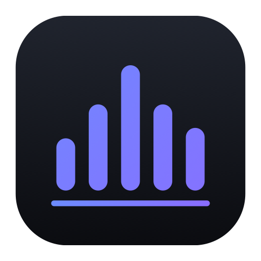

# Lina

[🇬🇧 English](README.md) · [🇫🇷 Français](README.fr.md) · [🇪🇸 Español](README.es.md) · **🇩🇪 Deutsch**

Ein natives SIP-Softphone für macOS: klar, schnell, privat.

[**⬇︎ Lina.dmg herunterladen**](https://github.com/Titi257/lina/releases/latest/download/Lina.dmg)

---

Telefonieren Sie auf Ihrem Mac mit jedem SIP-Anbieter oder jeder Telefonanlage (Asterisk, FreePBX, 3CX, OVH und andere). Universelle App (Intel und Apple Silicon). Die Oberfläche ist auf Deutsch, Englisch, Französisch und Spanisch verfügbar, je nach Sprache Ihres Mac oder nach Ihrer Wahl in den Einstellungen von Lina.

- **Anrufe, die einfach funktionieren:** Halten, unbetreute und betreute Weiterleitung, Anklopfen mit Wechsel per Klick, DTMF-Tastenfeld, Mailbox-Anzeige, klare Gründe bei fehlgeschlagenen Anrufen (besetzt, unbekannte Nummer).
- **Klicken zum Anrufen:** Nummern im Browser, im CRM oder in Kontakte (Links `tel:`, `callto:`, `sip:`) rufen über Lina an.
- **Überprüfbare Sicherheit:** Signalisierung über TLS und Sprache über SRTP, mit einer ehrlichen Anzeige, die „verschlüsselt“ nur dann zeigt, wenn der Ton es wirklich ist.
- **Für den Mac gemacht:** Steuerung über die Menüleiste, Mitteilungen mit Annehmen / Ablehnen, „Nicht stören“, ein globaler Kurzbefehl (⌃⌥Leertaste) zum Annehmen oder Auflegen, automatische Updates.
- **Privat:** kein Benutzerkonto, keine Telemetrie. Passwörter bleiben im macOS-Schlüsselbund, alles andere bleibt auf Ihrem Mac.

### Kostenlos und Pro

Die kostenlose Version ist zeitlich unbegrenzt und unterstützt einen SIP-Account. Jede neue Installation enthält **14 Tage Lina Pro**.

**Lina Pro, 29 € pro Benutzer, Einmalkauf** (Updates der Version 1 inklusive):
Anrufaufnahme, Namen aus den Kontakten des Mac, mehrere SIP-Accounts, betreute Weiterleitung, unbegrenzter Verlauf mit CSV-Export, Anrufstatistiken.

[Lina Pro kaufen](https://kevin-boileux.com/de/lina#acheter)

## Voraussetzungen

- macOS 14 (Sonoma) oder neuer, Intel oder Apple Silicon.
- Ein SIP-Account bei einem Anbieter oder einer Telefonanlage.

## Installation

1. Laden Sie **`Lina.dmg`** aus dem [neuesten Release](https://github.com/Titi257/lina/releases/latest) herunter.
2. Öffnen Sie die Datei und ziehen Sie **Lina** in den Ordner **Programme**.
3. Öffnen Sie Lina und fügen Sie Ihren SIP-Account unter **Accounts** hinzu.

## Links

- Website: [kevin-boileux.com/de/lina](https://kevin-boileux.com/de/lina)
- Datenschutzerklärung: [kevin-boileux.com/de/lina/confidentialite](https://kevin-boileux.com/de/lina/confidentialite)
- Lizenzvertrag: [EULA.md](EULA.md) (Französisch), [deutsche Fassung](https://kevin-boileux.com/de/lina/licence)
- Support: contact@kevin-boileux.com

Dieses Repository dient nur der Verteilung der App. Lina ist proprietäre Software von KB Digital Services LLC.
