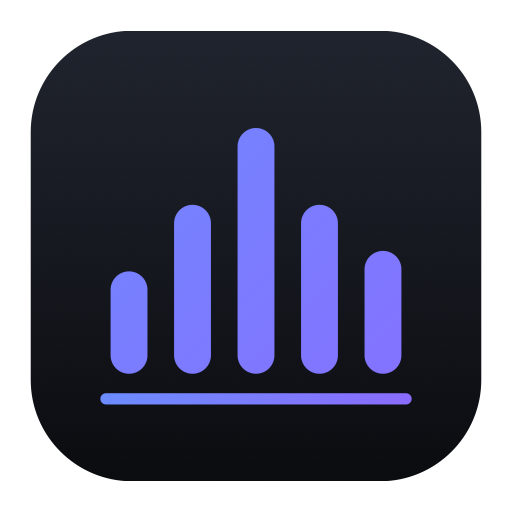

# Lina

[🇬🇧 English](README.md) · [🇫🇷 Français](README.fr.md) · **🇪🇸 Español**

Un softphone SIP nativo para macOS: claro, rápido y privado.

[**⬇︎ Descargar Lina.dmg**](https://github.com/Titi257/lina/releases/latest/download/Lina.dmg)

---

Haz y recibe llamadas en tu Mac con cualquier operador SIP o centralita (Asterisk, FreePBX, 3CX, OVH y otros). Aplicación universal (Intel y Apple Silicon). La interfaz está en francés.

- **Llamadas que funcionan:** espera, transferencia ciega y asistida, llamada en espera con cambio de línea en un clic, teclado DTMF, indicador de buzón de voz, motivo claro cuando una llamada falla (ocupado, número desconocido).
- **Llamar con un clic:** los números de tu navegador, CRM o Contactos (enlaces `tel:`, `callto:`, `sip:`) llaman con Lina.
- **Seguridad comprobable:** señalización TLS y voz SRTP, con un indicador honesto que solo dice «cifrado» cuando la voz realmente lo está.
- **Hecha para Mac:** barra de menús, notificaciones con Responder y Rechazar, modo No molestar, atajo global (⌃⌥Espacio) para responder o colgar, actualizaciones automáticas.
- **Privada:** sin cuenta ni telemetría. Las contraseñas se quedan en el llavero de macOS y todo lo demás en tu Mac.

### Gratis y Pro

La versión gratuita no tiene límite de tiempo y gestiona una cuenta SIP. Cada instalación nueva incluye **14 días de Lina Pro**.

**Lina Pro, 29 € por usuario, pago único** (actualizaciones de la versión 1 incluidas):
grabación de llamadas, nombres de los Contactos del Mac, varias cuentas SIP, transferencia asistida, historial ilimitado con exportación CSV, estadísticas de llamadas.

[Comprar Lina Pro](https://kevin-boileux.com/fr/lina#acheter)

## Requisitos

- macOS 14 (Sonoma) o posterior, Mac Intel o Apple Silicon.
- Una cuenta SIP de un operador o una centralita.

## Instalación

1. Descarga **`Lina.dmg`** desde la [última versión](https://github.com/Titi257/lina/releases/latest).
2. Ábrelo y arrastra **Lina** a **Aplicaciones**.
3. Abre Lina y añade tu cuenta SIP en **Comptes**.

## Enlaces

- Web: [kevin-boileux.com/fr/lina](https://kevin-boileux.com/fr/lina)
- Política de privacidad: [kevin-boileux.com/fr/lina/confidentialite](https://kevin-boileux.com/fr/lina/confidentialite)
- Contrato de licencia: [EULA.md](EULA.md) (en francés)
- Soporte: contact@kevin-boileux.com

Este repositorio solo distribuye la aplicación. Lina es software propietario de KB Digital Services LLC.
