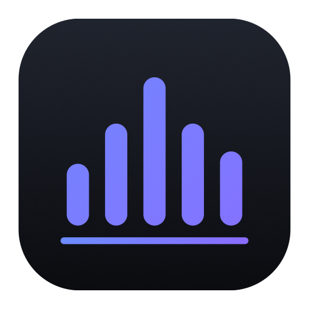

# Lina

[🇬🇧 English](README.md) · **🇫🇷 Français** · [🇪🇸 Español](README.es.md)

Un softphone SIP natif pour macOS : clair, rapide, confidentiel.

[**⬇︎ Télécharger Lina.dmg**](https://github.com/Titi257/lina/releases/latest/download/Lina.dmg)

---

Passez et recevez vos appels sur votre Mac avec n'importe quel opérateur SIP ou standard téléphonique (Asterisk, FreePBX, 3CX, OVH et autres). Application universelle (Intel et Apple Silicon), en français, anglais et espagnol selon la langue de votre Mac.

- **Des appels qui fonctionnent :** mise en attente, transfert aveugle et supervisé, double appel avec bascule en un clic, clavier DTMF, indicateur de messagerie vocale, raison claire quand un appel échoue (occupé, numéro inconnu).
- **Appel en un clic :** les numéros de votre navigateur, de votre CRM ou de Contacts (liens `tel:`, `callto:`, `sip:`) appellent avec Lina.
- **Une sécurité vérifiable :** signalisation TLS et voix SRTP, avec un badge honnête qui n'affiche « chiffré » que si la voix l'est vraiment.
- **Pensé pour le Mac :** barre des menus, notifications avec Répondre et Refuser, mode Ne pas déranger, raccourci global (⌃⌥Espace) pour répondre ou raccrocher, mises à jour automatiques.
- **Confidentiel :** ni compte ni télémétrie. Les mots de passe restent dans le trousseau macOS, tout le reste sur votre Mac.

### Gratuit et Pro

La version gratuite n'a pas de limite de durée et gère un compte SIP. Chaque nouvelle installation inclut **14 jours de Lina Pro**.

**Lina Pro, 29 € par utilisateur, achat unique** (mises à jour de la version 1 comprises) :
enregistrement des appels, noms des Contacts du Mac, comptes SIP multiples, transfert supervisé, historique illimité avec export CSV, statistiques d'appels.

[Acheter Lina Pro](https://kevin-boileux.com/fr/lina#acheter)

## Configuration requise

- macOS 14 (Sonoma) ou plus récent, Mac Intel ou Apple Silicon.
- Un compte SIP chez un opérateur ou sur un standard.

## Installation

1. Téléchargez **`Lina.dmg`** depuis la [dernière version](https://github.com/Titi257/lina/releases/latest).
2. Ouvrez-le et glissez **Lina** dans **Applications**.
3. Lancez Lina, puis ajoutez votre compte SIP dans **Comptes**.

## Liens

- Site : [kevin-boileux.com/fr/lina](https://kevin-boileux.com/fr/lina)
- Politique de confidentialité : [kevin-boileux.com/fr/lina/confidentialite](https://kevin-boileux.com/fr/lina/confidentialite)
- Contrat de licence : [EULA.md](EULA.md)
- Support : contact@kevin-boileux.com

Ce dépôt sert uniquement à distribuer l'application. Lina est un logiciel propriétaire de KB Digital Services LLC.
