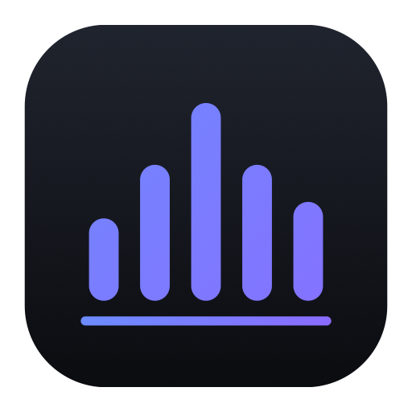

# Lina

**🇬🇧 English** · [🇫🇷 Français](README.fr.md) · [🇪🇸 Español](README.es.md)

A native SIP softphone for macOS: clear, fast, private.

[**⬇︎ Download Lina.dmg**](https://github.com/Titi257/lina/releases/latest/download/Lina.dmg)

---

Make and receive calls on your Mac with any SIP provider or PBX (Asterisk, FreePBX, 3CX, OVH, and others). Universal app (Intel and Apple Silicon). The interface is in English, French and Spanish, following your Mac's language or the one you pick in Lina's Settings.

- **Calls that just work:** hold, blind and attended transfer, call waiting with one click to switch lines, DTMF keypad, voicemail indicator, clear reasons when a call fails (busy, unknown number).
- **Click to call:** numbers in your browser, CRM or Contacts (`tel:`, `callto:`, `sip:` links) call through Lina.
- **Security you can check:** TLS signaling and SRTP audio, with an honest badge that says « encrypted » only when the audio really is.
- **Built for the Mac:** menu bar control, notifications with Answer / Decline, Do Not Disturb, a global shortcut (⌃⌥Space) to answer or hang up, automatic updates.
- **Private:** no account, no telemetry. Passwords stay in the macOS Keychain, everything else stays on your Mac.

### Free and Pro

The free version has no time limit and runs one SIP account. Every new install includes **14 days of Lina Pro**.

**Lina Pro, €29 per user, one-time purchase** (updates for version 1 included):
call recording, caller names from your Mac Contacts, multiple SIP accounts, attended transfer, unlimited history with CSV export, call statistics.

[Buy Lina Pro](https://kevin-boileux.com/fr/lina#acheter)

## Requirements

- macOS 14 (Sonoma) or later, Intel or Apple Silicon.
- A SIP account from a provider or a PBX.

## Install

1. Download **`Lina.dmg`** from the [latest release](https://github.com/Titi257/lina/releases/latest).
2. Open it and drag **Lina** into **Applications**.
3. Open Lina, then add your SIP account in **Comptes**.

## Links

- Website: [kevin-boileux.com/fr/lina](https://kevin-boileux.com/fr/lina)
- Privacy policy: [kevin-boileux.com/fr/lina/confidentialite](https://kevin-boileux.com/fr/lina/confidentialite)
- License agreement: [EULA.md](EULA.md) (French), [English version](https://kevin-boileux.com/en/lina/licence)
- Support: contact@kevin-boileux.com

This repository only distributes the app. Lina is proprietary software by KB Digital Services LLC.
